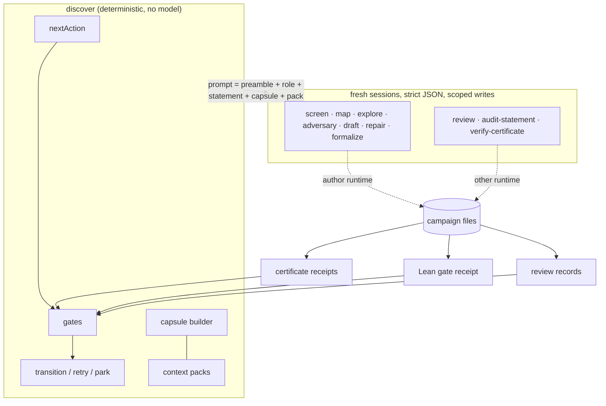

# Discovery harness

A gated research pipeline that runs **Claude Code and Codex** on open mathematical statements and records only what it can defend:

screen → map → explore → draft → review → formalize (Lean) → publish

It was reverse-engineered from [solved-conjectures](docs/reverse-engineering.md), a GPT-6.2 Astra / Codex pipeline that published hundreds of results in nine days. It keeps that pipeline's verification habits and replaces its weak points with machine-checked gates:
- **Independence:** review and verification come from the other runtime.
- **Hash binding:** each verdict is bound to the exact proof hash.
- **Pinned Lean statement:** the statement is audited, then pinned by fingerprint.
- **Computed labels:** the verification label is derived from receipts.
- **Fresh sessions:** every step starts from a small capsule instead of a growing transcript.



## Quick start

```sh
node harness/bin/discover.mjs doctor                         # runtimes, lake, python, config
node harness/bin/discover.mjs new my-target --title "…" --source https://arxiv.org/abs/…
$EDITOR campaigns/my-target/STATEMENT.md                     # exact statement, source, conventions, scope
node harness/bin/discover.mjs run my-target --until review --max-steps 20
node harness/bin/discover.mjs status my-target               # gate checks and the next action
cat campaigns/my-target/CAPSULE.md                           # everything you need to resume
```

Finding a target: `discover scout --area "spectral graph theory" --count 6`. The screen stage then rejects prior resolutions and low-impact targets.

Working inside an interactive Claude Code or Codex session: `discover step my-target --runtime manual --as claude-interactive` writes the step's prompt. Do the step, then `discover record my-target <run-id>`. The `discovery-loop` skill explains this in both tools.

## What each stage must produce

| Stage | Role(s) | Gate (checked from files, see `lib/gates.mjs`) |
|---|---|---|
| screen | screen | Exact statement and source pinned; ≥3 recorded queries and ≥3 sources read; verdict `eligible`; significance, full vs partial, attack. Statement hash frozen. |
| map | map | ≥2 directions with distinct lenses, each with a falsification test, milestone and budget; one adversarial. |
| explore | explore, adversary, verify-certificate | Every attempt recorded (claim, method, outcome, next). A live promising attempt. Every certificate has an independently written verifier and a passing receipt. |
| draft | draft | PROOF.md: result kind, main claim, Claims table (statuses proved/cited/computed/assumed/open, dependencies, evidence), one section per claim, digest. No `complete` result resting on open or assumed claims. |
| review | review ×2, repair | ≥2 pass verdicts bound to the current PROOF.md hash, one from an identity other than the author; no blocking defect. |
| formalize (optional) | formalize-statement, audit-statement, formalize | Statement audited by the other runtime and fingerprint-pinned; Lean gate passes; receipt current. |
| publish | none (generated) | `results/<slug>/README.md` and the index, generated from the record; optional draft PR. |

## Layout

```
harness/
  bin/discover.mjs        CLI (help: node harness/bin/discover.mjs help)
  lib/                    orchestrator, gates, claims, certificates, lean gate, capsule, prompts, runtimes, publish, reconcile
  prompts/                _preamble.md + one prompt per role (frontmatter: schema, budget, inputs, writes, effort, maxTurns)
  schemas/                strict JSON output schemas (Codex- and Claude-compatible)
  templates/              campaign files (STATEMENT.md, AGENTS.md, CLAUDE.md) and a Lean project skeleton
  runtime/                canonical skills and subagents → .claude/, .agents/, .codex/ via install-runtime
  test/                   offline tests (fake runtimes, fake lake), Lean negative controls, end-to-end fixture
  docs/                   reverse-engineering, lifecycle, context economy, Lean gate, runtimes and operations
campaigns/<slug>/         one directory per target (created on demand)
results/<slug>/           generated landing pages
```

## Documentation

- [How solved-conjectures works, and what this harness takes from it](docs/reverse-engineering.md)
- [Campaign lifecycle: stages, roles, gates, artifacts, labels](docs/lifecycle.md)
- [Context economy: capsule, packs, caching, retrieval](docs/context-economy.md)
- [The Lean gate](docs/lean-gate.md)
- [Runtimes, routing, permissions, scheduling, Math Commons coordination](docs/runtimes.md)
- Prompts: [`prompts/`](prompts/). Each one is the complete procedure for its role.

## Testing

```sh
node --test harness/test/*.test.mjs          # offline: fake claude/codex/lake; Lean tests skip without lake
node harness/bin/discover.mjs install-runtime --check
```

CI (`.github/workflows/harness.yml`) runs the offline suite, then installs Lean and runs two more things on the real toolchain:
- the gate's negative controls: sorry, a custom axiom, `native_decide`, a weakened theorem, and a tampered statement;
- the end-to-end fixture campaign.

The fixture is Euler's n²+n+41, a classical fact used only to exercise every stage. It is labelled as a fixture everywhere and never counted as a result.

## Honest limits

- The gates check structure, provenance, hashes and Lean. They do not check whether an informal proof is correct; that is what independent reviews are for, and their verdicts are only as good as the reviewers.
- Statement fidelity in Lean rests on the audit. The pin only guarantees that what was audited is what was proved.
- No live model run is part of CI. Driver behaviour is tested against the real CLIs' output protocols with fake executables.
