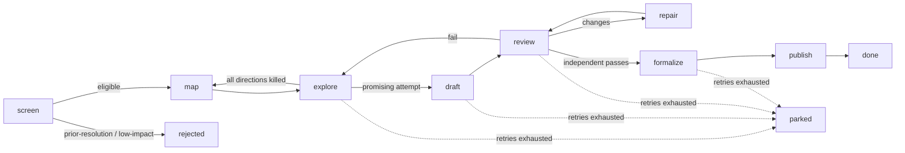

# Campaign lifecycle

<!-- digest -->
A campaign moves through screen → map → explore → draft → review → formalize → publish → done, or stops at rejected or parked. Each stage has one or more roles (fresh model sessions with a fixed prompt, schema and write scope) and a deterministic gate in `lib/gates.mjs`. The orchestrator (`nextAction` in `lib/orchestrator.mjs`) decides every transition from files and receipts. Retries are bounded per stage; exhaustion parks the campaign with a recorded reason.
<!-- /digest -->

## Campaign directory

| Path | Written by | Notes |
|---|---|---|
| `campaign.json` | orchestrator | stage, polarity, counters, Lean config, pinned hashes, history |
| `STATEMENT.md` | operator, screen | exact statement, source, conventions, scope; frozen (sha256) when screening passes |
| `SCREEN.md`, `screen.json` | screen | decision, search log, significance, attacks |
| `MAP.md`, `directions.json` | map | problem map; 2–4 directions with lens, kind, falsification test, milestone, budget |
| `attempts/<D>/<NNN>.md`, `ledger.jsonl` | explore/adversary; orchestrator | one report per attempt; one ledger line per attempt (claim, method, outcome, status, failure point, next) |
| `certificates/<name>/` | explore/adversary (data, manifest); verify-certificate (verifier); orchestrator (`receipt.json`, `output.txt`, `provenance.json`) | exact certificate plus an independent verifier plus a hash-bound receipt |
| `PROOF.md`, `proof/` | draft, repair | result kind, main claim, Claims table, one section per claim, scope, reproduction |
| `reviews/review-NNN.{md,json}` | review; orchestrator | verdict, defects and checks, bound to the PROOF.md hash and the certificate hashes |
| `formal/`, `STATEMENT_REVIEW.md` | formalize-statement, audit-statement, formalize | Lean project; mapping table and audit verdict |
| `receipts/lean-latest.json` (+ `.txt` logs) | Lean gate | see [lean-gate.md](lean-gate.md) |
| `CAPSULE.md` | orchestrator | regenerated after every step; see [context-economy.md](context-economy.md) |
| `runs.jsonl`, `.runs/<id>/` | orchestrator | every run: role, runtime, identity, status, usage, prompt size; prompts and answers (git-ignored) |
| `AGENTS.md`, `CLAUDE.md` | template | campaign-local rules that Codex and Claude Code load automatically |

## Stages

### screen

- **Role:** `screen`, routed to Claude by default for web research.
- **Input:** STATEMENT.md.
- **Output:** SCREEN.md, screen.json, and a filled STATEMENT.md.
- **Gate:**
  - STATEMENT.md has a filled `## Exact statement`, a `## Source` with a URL, arXiv ID or DOI, and a `## Scope`.
  - Verdict `eligible`, or `fixture` for test campaigns only.
  - At least `screen.minQueries` recorded queries, and at least `screen.minSources` sources read with URLs.
  - A significance argument (at least 80 characters), at least one attack, and full versus partial distinguished.
- **Transitions:**
  - Pass: freeze the STATEMENT.md hash and go to map.
  - A non-eligible verdict goes to rejected.
  - Two failed rounds park the campaign.

### map

- **Role:** `map`.
- **Output:** MAP.md (objects and conventions, smallest cases worked exactly, known tools with hypotheses checked, lenses, where it should break) and directions.
- **Gate:**
  - At least `explore.minDirections` directions with distinct lenses.
  - Each direction has a falsification test, a milestone and a budget.
  - At least one direction is `adversarial`.

### explore

Each round runs up to `explore.parallel` open directions concurrently, alternating runtimes. Adversarial directions get the `adversary` role; the others get `explore`. Before the gate, the orchestrator does two things:

1. For each new certificate without a verifier, it runs `verify-certificate` on the runtime that did not generate it.
2. It runs every verifier to produce receipts.

- **Gate:**
  - Every attempt records its claim, method, outcome and next action.
  - At least one live attempt is `promising` or `resolved`, with outcome proof-sketch, counterexample, reduction or partial.
- **Transitions:**
  - All directions killed: one re-map. The old directions are archived, and the capsule's "Do not retry" list carries over.
  - Then `explore.maxRounds` rounds, after which the campaign is parked.

### draft

- **Role:** `draft`, the author runtime. The author identity is recorded.
- **Input:** the promising attempts in full, the certificate index, and the map sections.
- **Gate** (`claimProblems`):
  - A declared result kind and main claim.
  - A Claims table: every row has a valid status and a `### C<n>` section, every dependency exists, and there are no cycles.
  - `cited`/`assumed` claims name their source.
  - `computed` claims cite `certificates/<name>` with a passing, current receipt.
  - A `complete` kind with an open or assumed dependency is rejected.
  - A digest block, and a size under the limit.

### review

- **Roles:** `review`, run fresh each time and alternating reviewer and author runtimes. On defects, `repair`.
- **Reviewer input:** STATEMENT.md, PROOF.md, the certificate index and the appendix list only. Never attempts, the ledger or the map.
- **Gate:** the draft gate, plus:
  - at least `review.passes` pass verdicts whose `proofSha256` equals the current hash and whose certificate key matches;
  - no blocking defect on the current hash;
  - some pass from an identity other than the author's.
- **Transitions:**
  - `changes` or a blocking defect: repair. This makes every earlier verdict stale. Bounded by `review.maxRepairRounds`.
  - `fail`: the route's directions are killed and the campaign returns to explore.

### formalize

Skipped unless `formal.required` is set or `discover set SLUG formal on` was run, which requests it per campaign. A skipped campaign keeps its label at ⬜, or at 🟢 when backed by receipts.

1. `formalize-statement` writes `formal/` with `def Claim : Prop` only, plus mapping notes.
2. The gate runs in fingerprint mode and records the statement fingerprint. Main is expected to be missing at this point.
3. `audit-statement` runs on the other runtime and writes the `## Audit` table and verdict.
4. **Pin.** The gate runs again; the fingerprint must equal the one the auditor saw. It is then stored as `lean.claimFingerprint`.
5. `formalize` and the gate alternate until the gate passes, bounded by `formal.maxRounds`.

### publish

`discover publish` checks the review gate, then generates `results/<slug>/README.md` entirely from the record:
- the digest, exact target and source;
- the proof hash, reviews, certificates and Lean receipt;
- the scope;
- the computed label.

It also refreshes the index table in `results/README.md` between its markers. Adding `--open-pr` creates the branch `discovery/<slug>`, commits, pushes and opens a **draft** PR whose body is generated from the record.

## Verification label (computed, never chosen)

| Label | Condition |
|---|---|
| ✅ | Current passing Lean receipt; fingerprint equals the pin; result kind `complete` |
| 🟢 | Current passing Lean receipt short of the above, plus at least one passing certificate |
| 🟡 | Current passing Lean receipt short of ✅, with no certificate |
| ⬜ | No current passing Lean receipt (the text says whether exact computer checks back the proof) |

## Operator controls

- `discover set SLUG polarity prove|disprove`
- `set SLUG budget N`
- `set SLUG formal on|off`
- `set SLUG stage STAGE --reason …`: resets the retry counters and is written to history.
- `set SLUG pending none`: abandons a manual run.
- `set SLUG lean '{"modules":[…],"claim":…,"main":…}'`

Every change is appended to `campaign.json` history.
