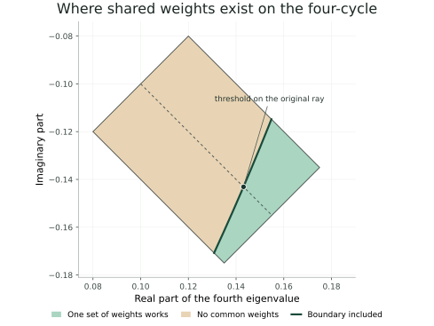

# An exact circular boundary for the moving fourth eigenvalue

For the archived four-cycle unitary and fixed noncollinear second spectrum,
the fourth-eigenvalue transition extends to a genuine two-dimensional region.
Write

$$a_3=z=s(1-i)+t(1+i),\qquad
\frac1{10}\le s\le\frac{31}{200},\quad -\frac1{50}\le t\le\frac1{50}.$$

There exists **one probability distribution on the 24 spectral pairings that
reconstructs the determinant for every complex triple $(a_0,a_1,a_2)$ if and
only if**

$$\boxed{q(s,t)=1808(s^2+t^2)+2187s+1079t-350\ \ge0.}$$

Equality is included. On the boundary an explicit twelve-term formula has
eleven positive masses and one zero mass. Below it, a real functional
separates the target from every one of the 24 pairing coefficient vectors.
Both sides and all edges of the displayed parameter region are proved by exact
polynomial identities and sign certificates.

In the original coordinates $z=x+iy$, this boundary is the circle

$$904(x^2+y^2)+1633x-554y-350=0,$$

with center $(-1633/1808,554/1808)$ and squared radius
$4239205/1808^2$. **Within the certified parallelogram**, the circle exterior is
feasible and the interior is excluded.



The colored region concerns a common mixture for **all remaining complex
triples**. White space is unclassified by this local chart. The picture is an
illustration; the exact polynomial certificate is the proof.

The exclusion does not identify a pointwise MDO counterexample: individual
triples may have different convex weights. No classification outside this
region, general MDO resolution, or independent-owner approval is claimed.

## 1. Fixed data and relation to the ray

The unitary and spectrum are unchanged:

$$
U=\frac1{625}\begin{pmatrix}
-31&492&-240&300\\-300&225&500&0\\
240&-180&225&500\\-492&-256&-180&225
\end{pmatrix},\qquad b=(3-2i,2,1+2i,-i).
$$

Set $B=U\operatorname{diag}(b)U^*$ and $A=\operatorname{diag}(a_0,a_1,a_2,z)$.
These are normal matrices. A permutation $p$ maps input columns to output rows,
and its vertex is $v_p(a)=\prod_j(a_{p(j)}+b_j)$.
The other three eigenvalues remain arbitrary complex numbers; the weights may
depend on $z$, but not on that triple.

The earlier [exact ray classification](../fourth-boundary/README.md) is
recovered at $t=0$. Its cubic factors as

$$1808s^3+9419s^2+8398s-1400=(s+4)(1808s^2+2187s-350).$$

Thus its boundary $\alpha\approx0.143106204978043899$ is also the positive root
of this quadratic. The factorization simplifies its description without
changing the earlier theorem.

The present region has area $11/5000$ in $(s,t)$ coordinates, or $11/2500$ in
$(x,y)$ coordinates. It includes transverse motion on both sides of the ray,
not only a second finite collection of points.

## 2. A twelve-support bivariate certificate

Expand both the determinant and every pairing vertex as multiaffine polynomials
in $a_0,a_1,a_2$. Normalization and the real and imaginary parts of their eight
coefficients form

$$M(s,t)w=d(s,t),$$

with 17 real rows and 24 columns. Every entry is affine in $s,t$. The row order
is normalization, then subsets of $\{0,1,2\}$ by size and lexicographic order,
with real part before imaginary part. The coefficient formulas are inherited
from [moving-fourth-spectrum](../moving-fourth-spectrum/README.md) and computed
directly by the checker.

Use the first twelve-permutation support of the ray proof, stored explicitly in
[certificate.json](certificate.json), and rows

$$R=(0,5,2,3,4,1,6,9,8,10,11,12)$$

to form a $12\times12$ matrix $C(s,t)$. Define

$$D=\det C,\qquad N_j=\det(C\text{ with column }j\text{ replaced by }d_R).$$

The file contains their exact rational polynomial coefficients. Each term
`[i,j,"rational"]` means that rational coefficient times $s^it^j$.
All 17 cleared equations

$$\sum_j M_{ij}(s,t)N_j(s,t)=d_i(s,t)D(s,t)$$

are verified as identities of bivariate polynomials, not just evaluations on
the ray. They include $\sum_jN_j=D$.

The denominator and all numerators except the one with zero-based index 1 are
strictly positive throughout the closed rectangle. The replay proves this by
converting each polynomial to the tensor-product Bernstein basis on the exact
rational box and checking that every control coefficient is positive.
The basis functions are nonnegative and sum to one everywhere on the box.
This gives an interval proof, rather than a grid-based sign inference.

## 3. The exact factorization that exposes the circle

Put

$$K(s,t)=(7s-t)(s^2+t^2)(s+3t+4)^2(s^2+3s+t^2+1).$$

The critical numerator and denominator factor exactly as

$$N_1(s,t)=\frac{57344}{5}K(s,t)q(s,t),$$

$$D(s,t)=-280000000K(s,t)(s^2+t^2+t-1).$$

The checker expands the products and compares every coefficient with the
archived raw Cramer polynomials. It also proves $K>0$ and $D>0$ throughout the
box. In particular, the critical convex mass has the simple expression

$$w_1(s,t)=\frac{16q(s,t)}{390625(1-s^2-t^2-t)}.$$

The remaining eleven masses are $N_j/D>0$. Therefore, when $q\ge0$, the twelve
weights are nonnegative, sum to one, and satisfy every coefficient identity.
They reconstruct the determinant for all complex triples. When $q=0$ exactly
one mass vanishes; no division by $q$ occurs, so the boundary is included.
The exact remaining weight polynomials and their permutation order are in the
certificate file. Their values are not constant as the fourth eigenvalue moves.

## 4. One cofactor functional excludes the whole other side

For a real 17-vector $v$, define the real linear functional

$$L_{s,t}(v)=\det(C(s,t)\text{ with column }1\text{ replaced by }v_R).$$

For each of the 24 pairing columns, let $H_p=L_{s,t}(M_p)$. All $H_p$ are stored
in the same certificate. Exactly eleven vanish identically because the
replacement repeats another selected column. Every other one is strictly
positive throughout the box, again proved by Bernstein controls. Thus
$L_{s,t}$ is nonnegative on every nonnegative combination of pairing columns.
But

$$L_{s,t}(d)=N_1=\frac{57344}{5}Kq.$$

Since $K>0$, this is strictly negative whenever $q<0$. No nonnegative solution
to $Mw=d$ can exist on that side, even if all 24 permutations are allowed.
This dual uses the **same unnormalized cofactor orientation** as the primal;
no uncertain sign or vanishing normalization is suppressed.

### Why the finite interpolation check is an identity proof

Each cofactor is a determinant of order twelve with entries affine in $s,t$,
so its total degree is at most twelve. The stored coefficient arrays are
explicitly checked against this degree bound. The verifier recomputes the 37
polynomials ($D$, twelve $N_j$, and 24 $H_p$) on the exact grid
$\{0,\ldots,12\}^2$. A polynomial of degree at most twelve in each variable
that vanishes on this grid is identically zero: apply univariate root counting
in one variable and then the other. Thus the 169 evaluations prove the
recorded cofactor identities everywhere. This is separate from the Bernstein
sign proof, which covers the entire parameter box.

## 5. The moving boundary is explicit and nonconstant

On the box,

$$q_s=3616s+2187>0,\qquad q_t=3616t+1079>0.$$

The left edge $s=1/10$ has $q<0$ for every allowed $t$, and the right edge
$s=31/200$ has $q>0$. Each transverse slice therefore has exactly one boundary:

$$s=\phi(t)=\frac{-2187+\sqrt{2187^2-7232(1808t^2+1079t-350)}}{3616}.$$

The radical is positive on the entire closed $t$ interval. The feasible part
of that slice is $s\ge\phi(t)$ and the excluded part is $s<\phi(t)$.
The exact derivative bounds

$$-\frac12<\phi'(t)=-\frac{3616t+1079}{3616\phi(t)+2187}<-\frac13$$

follow from $q_s-2q_t>0$ and $3q_t-q_s>0$, also checked on the full box.
In particular the boundary genuinely moves as the fourth eigenvalue moves
transversely. The two endpoints $t=\pm1/50$ are covered, and their boundary
points have the same valid eleven-positive/one-zero certificate.
`boundary_bracket(t)` supplies exact rational brackets for the radical; it does
not replace the algebraic boundary by a rounded float.

## 6. Reproduction and provenance

Python 3.9+ and standard library only. From the repository root:

```sh
python3 -B research/marcus-de-oliveira/fourth-boundary-plane/plane.py
python3 -B -m unittest discover -s research/marcus-de-oliveira/fourth-boundary-plane -p 'test_*.py' -v
python3 -B research/marcus-de-oliveira/fourth-boundary-plane/plane.py --t 1/50
```

The first command reproduces [verification.json](verification.json), including
all cleared identities, ring factorizations, exact cofactor interpolation,
Bernstein signs, and endpoint/slope statements. Seven tests include changing
critical and noncritical masses, dropping a dual column, rejecting floats and
out-of-domain parameters, bracketing both transverse endpoints, and independent
determinant reconstruction with noncollinear complex spectra at three feasible
points, including both transverse endpoints. They also verify that the weights change across the region.
Local validation used Python 3.9.6; report output has no version-dependent fields.

Optional coefficient reconstruction:

```sh
python3 -B research/marcus-de-oliveira/fourth-boundary-plane/derive.py --output /tmp/fourth-plane-rederived.json
```

This is exact Cramer interpolation using the standard library, with no LP or
symbolic-algebra package. Its output was compared with the stored certificate.
The proof uses the written determinant/degree arguments and exact sign checks;
it does not extrapolate floating samples.

Source progression: the archived unitary is from the
[single-cycle work](../single-cycle/README.md), the uniform three-variable
coefficient system from [PR22's moving spectrum work](../moving-fourth-spectrum/README.md),
and the initial support/dual from [PR33's ray boundary](../fourth-boundary/README.md).
The coordinator supplied the exact circle factorization, proposed the larger
box and prepared the plot; all ring identities and enlarged-box signs were
independently replayed here under the same GitHub owner. This is not an
independent-owner review.

Claude's merged [PR34](https://github.com/g4nesh/math-commons/pull/34) enlarges a
Hermitian/collinear cross-ratio range. Those spectral assumptions do not apply
to the fixed noncollinear $b$ here, so that result is complementary and is not
used as a premise. No overall novelty or formal-proof-assistant claim is made.
A next target is extension of this circular boundary or discovery of the next
active support/dual when leaving the certified parallelogram; the current
chart makes no claim about that unclassified region.
